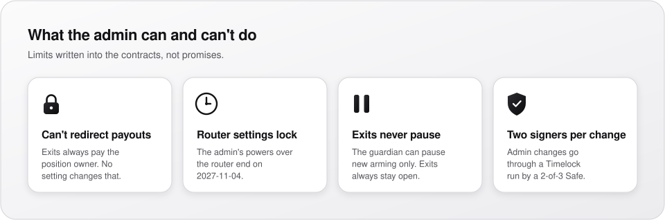

<p align="center">
  
</p>

# Canopy

Canopy watches the ERC-4626 vaults you hold. When an alarm you chose fires, such as a share-price drop, a vault drain or an exploit that independent watchers confirm, a keeper exits your position and sends the vault's asset to your own wallet.

The exit contract has no "send to" field. Every exit pays the position owner and nobody else. A faulty keeper or a false report can, at worst, take you out early.

Canopy runs on **Robinhood Chain** (chain 4663). Base is planned next.

**CA (CNPY):** [`0xDADa6B2D163970a7c0409fE81DFBE71FD800b8cE`](https://robinhoodchain.blockscout.com/token/0xDADa6B2D163970a7c0409fE81DFBE71FD800b8cE) on Robinhood Chain

> **Status:** live on Robinhood Chain mainnet since 2026-11-04. The contracts have **not had an external audit yet**. Use small amounts until one is published here.

## Research suite

Ten new tools cover oracle inputs, control roles, shared exposure, idle-liquidity shocks, RH Lighter markets, funding references, session planning, evidence signatures, agent heartbeats and observation changes. Open `research.html` after deploying this release. See the [launch guide](docs/research-launch.md) for capabilities, limits and deployment checks. These tools read or verify data; they do not activate trades or exits.

## How it works

<p align="center">
  
</p>

1. **Check a wallet.** The web app reads your vault positions in your browser. It never asks for a seed phrase, a login or any ID.
2. **Pick alarms.** Each launch vault has presets: vault loss (share price down more than 0.5%), exploit confirmed (2 of 3 approved watchers), vault drain, and curator change.
3. **Arm once.** Approve your vault shares to the `ExitRouter` and arm the position.
4. **If an alarm fires,** a keeper calls the router, which redeems your shares and pays the asset to you.
5. **Exit Now and Disarm All** work at any time, and they're free.

### Alarms

<p align="center">
  
</p>

### Contracts

| Contract | Role |
|---|---|
| `AlarmBook` | Registry of alarm detectors. Anyone can register one or `poke` it; a quorum alarm fires only on signatures from approved watchers. |
| `ExitRouter` | Holds armed positions and runs exits. It always pays the owner. |
| `ERC4626Adapter` | Redeems ERC-4626 vault shares for the router. |
| `Timelock` | The admin of `AlarmBook` and `ExitRouter`, controlled by a 2-of-3 Safe. |

### Admin limits

<p align="center">
  
</p>

- The admin can't move funds or change who gets paid: every payout goes to the position owner, and a position keeps its adapter.
- Its one effect on value is the optional exit to stablecoin, which swaps with the price feed and route set before you armed. A bad feed or route could make that swap pay less; a later change doesn't apply until the owner arms again. No feed or route is set today. See [SECURITY.md](SECURITY.md) for every role and the risks accepted.
- The router's admin powers end on **2027-11-04** (`ADMIN_EXPIRY`). After that, the router's settings can't change.
- A separate guardian Safe can pause **new arming only**. Exits always stay open.
- The `AlarmBook` admin manages the approved watcher list, and that role doesn't expire.

## Deployments

Robinhood Chain (4663), **v2**, deployed at block 107737863. Its services, keeper and web app run on these contracts.

| Contract | Address | Metadata hash (IPFS) |
|---|---|---|
| Timelock | [`0x4F656b09c4D3c859Dd2BB9919f384681e9ccb3f5`](https://robinhoodchain.blockscout.com/address/0x4F656b09c4D3c859Dd2BB9919f384681e9ccb3f5) | `QmTev1dshTPntB6tJenAWVp6VZWV8rPqLeXxCXgyUtk1ap` |
| AlarmBook | [`0x6A391f2c489dDFcb60Ad64eDddda5Ea0921584cf`](https://robinhoodchain.blockscout.com/address/0x6A391f2c489dDFcb60Ad64eDddda5Ea0921584cf) | `QmS4rbGtcLWKh6hbQGKhrovm2AaUX2Ste1i4MtrnY1SS61` |
| ExitRouter | [`0x1c3ca2B2f01C30B731909563Dad550062B340757`](https://robinhoodchain.blockscout.com/address/0x1c3ca2B2f01C30B731909563Dad550062B340757) | `QmRUSNy9XykyzNaVnvYnq64C3PfNakz4SQNNZWTUV6X4KA` |
| ERC4626Adapter | [`0x32C39abF03a12303Cc3150be50eD7b0e03Ab9D38`](https://robinhoodchain.blockscout.com/address/0x32C39abF03a12303Cc3150be50eD7b0e03Ab9D38) | `QmZVe2Wora2nfixtJxhhBM3p6eie67PpoKTpUQcNNEgXN7` |

Each metadata hash is the one at the end of the deployed bytecode, and `forge build` on `main` produces the same hash from `contracts/src`. All four are exact matches on Sourcify. `services/deploy/verify.ts` checks the live deployment against this source: all 58 checks pass.

v2 closes the contract findings of the internal reviews: no admin swap settings, arming only on a clear alarm, resettable detectors, a vault drain that counts only when paired with a same-day watcher quorum, expiring watchers and gas-capped reads. The broadcast record is in `contracts/broadcast/`.

**v1** (block 106087816) is retired: Canopy's services no longer watch it, and the only position ever armed on it was our own test, which holds nothing. Its source is the [`v1-deployed`](../../tree/v1-deployed) tag. Owners can always exit a v1 position themselves.

| Contract | Address | Metadata hash (IPFS) |
|---|---|---|
| Timelock | [`0xA37196aCb22146424C1984001c18F49877B10D9b`](https://robinhoodchain.blockscout.com/address/0xA37196aCb22146424C1984001c18F49877B10D9b) | `QmeQRVjhc1AMNeb7cbNjinuLTh6orcqvh7k2etSALd7QVL` |
| AlarmBook | [`0x550cC2Ad4c2f095c37B8362bd19c475Ab7576e4d`](https://robinhoodchain.blockscout.com/address/0x550cC2Ad4c2f095c37B8362bd19c475Ab7576e4d) | `QmT1qW4pSL6LswLamtSN52Khh44F7BW7UmbDiYPv2Zft9m` |
| ExitRouter | [`0xC867A4B38f7B9F7CCc121D61b2F8d200395a965C`](https://robinhoodchain.blockscout.com/address/0xC867A4B38f7B9F7CCc121D61b2F8d200395a965C) | `QmYkZvKCayuPRdYZVAQGruETkyTLBiAeTY8gQWUVDMtpui` |
| ERC4626Adapter | [`0x14E6f3a2Cd259148f983E2b01Fe778c5002c98BC`](https://robinhoodchain.blockscout.com/address/0x14E6f3a2Cd259148f983E2b01Fe778c5002c98BC) | `QmX5Umk9JxzSph7RKE8dtxy7xP1nquDb4kcFK4SrZNLNSi` |

## Repository

| Folder | What it holds |
|---|---|
| `contracts/` | Solidity contracts, tests and the deploy script (Foundry, solc 0.8.28) |
| `services/` | Keeper, indexer, watcher, risk-card detector and Telegram bot (Bun, TypeScript, Postgres). One image runs every role. |
| `web/` | The web app and landing page, a static build |
| `tools/` | The reproducible web build and small helpers |

## Build and test

You need [Foundry](https://getfoundry.sh) 1.8.6, [Bun](https://bun.sh) 1.4.4 and Postgres for the service tests.

```bash
cd contracts && forge build && forge test
```

```bash
cd services && bun install && bun test && bunx tsc --noEmit
```

```bash
cd web && bun install && bun test
```

### Check the web build

`tools/build-web.sh` builds the web app and prints a hash of every file it outputs. Anyone can rebuild from the same commit and compare.

```bash
tools/build-web.sh
```

## Deploy from a fresh clone

This is how the live deployment was made. Nothing here needs anything outside this repo.

1. **Settings.** Copy `deploy/launch.env.example` to `deploy/launch.env` (git ignores it) and fill in the token, feed and swap-router addresses, your two Safes (admin and guardian, both multisigs), the admin expiry and the Timelock delay. Copy `deploy/settings.example.json` to `deploy/settings.json` with the same values, plus the watchers and vaults.
2. **Preflight.** `cd services && bun deploy/preflight.ts <rpc url>` checks every setting, Safe, feed and vault against the live chain and lists what's missing. It sends nothing.
3. **Deploy.** From `contracts/`, with `deploy/launch.env` loaded and a deployer keystore, run the script once without `--broadcast` and read the simulated output, then run it again with `--broadcast`:

   ```bash
   forge script script/Deploy.s.sol:Deploy --rpc-url "$RPC" --keystore <deployer keystore> --sender "$DEPLOYER"
   ```

   The script stops on an unsafe setting: a wrong chain, a missing contract, the same Safe twice, or a plain wallet as admin. Keep `contracts/broadcast/`, because it's the record of what was deployed.
4. **Safe batches.** `cd services && bun deploy/plan.ts ../contracts/broadcast/Deploy.s.sol/<chain id>/run-latest.json ../deploy/settings.json <out dir>` writes `deployment.json` and the admin's first changes (adapter, watchers, alarm registrations) as Safe Transaction Builder files.
5. **Verify, then hand over.**
   - `cd services && bun deploy/verify.ts <out dir>/deployment.json "$RPC" deployed` checks the live bytecode against this build and every address and setting against what was intended. It reads expected values from the deployment file, never from the contracts it checks. Stop if any check fails.
   - The admin Safe's signers load and sign the setup batch.
   - Run the same command with `live` in place of `deployed` to check the result.
6. **Services.** Copy `deploy/services.env.example`, set the deployed addresses, and start each role (see [Run your own keeper](#run-your-own-keeper)).

## Audits

| Date | Kind | Commit | Report |
|---|---|---|---|
| 2026-11-06 | Second internal review | [`1fec06e`](https://github.com/CanopyRH/canopy-app/tree/1fec06e) | [Report](.audit-grade/2026-11-06/REPORT.md) |
| 2026-11-05 | Internal review | [`71c1fa0`](https://github.com/CanopyRH/canopy-app/tree/audit-2026-11-05) (tag `audit-2026-11-05`) | [Report](.audit-grade/2026-11-05/REPORT.md), [scope](.audit-grade/2026-11-05/SCOPE.md), [PoCs](.audit-grade/2026-11-05/POCS), [status of each finding](.audit-grade/findings.tsv) |

Every High, Medium and Low found in the services is fixed, with a regression test for each. The contract findings can't be fixed in deployed code, so they're accepted risks with off-chain mitigations, explained in [SECURITY.md](SECURITY.md). No external audit has been done yet. Changes since launch are in [CHANGELOG.md](CHANGELOG.md).

## Run your own keeper

Anyone can exit any armed position while one of its alarms is live, and the funds still go to the owner. To keep exits running without Canopy, run the indexer and the keeper together in one process (`ROLE` takes several roles joined by commas). They need no Telegram bot, no public URL and no plan settings:

```bash
cd services && ROLE=indexer,keeper KEEPER_PAID_ONLY=false \
  DATABASE_URL=postgres://... CHAIN_ID=4663 RPC_URL=https://... RPC_URL_BACKUP=https://... \
  ROUTER=0x1c3ca2B2f01C30B731909563Dad550062B340757 ALARM_BOOK=0x6A391f2c489dDFcb60Ad64eDddda5Ea0921584cf \
  ADAPTER_4626=0x32C39abF03a12303Cc3150be50eD7b0e03Ab9D38 START_BLOCK=107737863 \
  KEEPER_PRIVATE_KEY=0x... bun src/index.ts
```

The keeper key only pays gas, so fund it with a little ETH and nothing else. `KEEPER_PAID_ONLY=false` makes it run every armed position, not just paid ones. A database needs Postgres, and `services/Dockerfile` builds the image.

## Security

Report a vulnerability privately through this repository's **Security** tab ("Report a vulnerability"). Please don't open a public issue for it.

## License

- `contracts/`: MIT. The license line is part of the deployed bytecode, so these files stay exactly as deployed.
- Everything else: [PolyForm Noncommercial 1.0.0](LICENSE.md). Noncommercial use and study are free. Commercial use needs a separate license.

See [NOTICE](NOTICE) for third-party material.

Canopy is software. It doesn't promise any outcome and doesn't cover losses.

## Prepared expansion

The SDK and local MCP tools return owner-reviewed unsigned transactions. The app adds LP discovery,
reviewed stable payout choices and bounded underlying-position facts. The independent watcher kit is
in `watcher-node/`; outside signers still require Timelock approval.

New adapters/readers have no configured activation by default. BorrowGuard and CanopyArmPolicy are
audit candidates, not live borrower or smart-account integrations. V4 is hookless-only preparation,
without a production manager configuration. Stable routes remain empty until independently reviewed.
Perp close planning and credit accounting are internal preparation, not live exchange execution or new fees.
Read each component's README before integrating it. Existing owner exits remain available without these additions.
